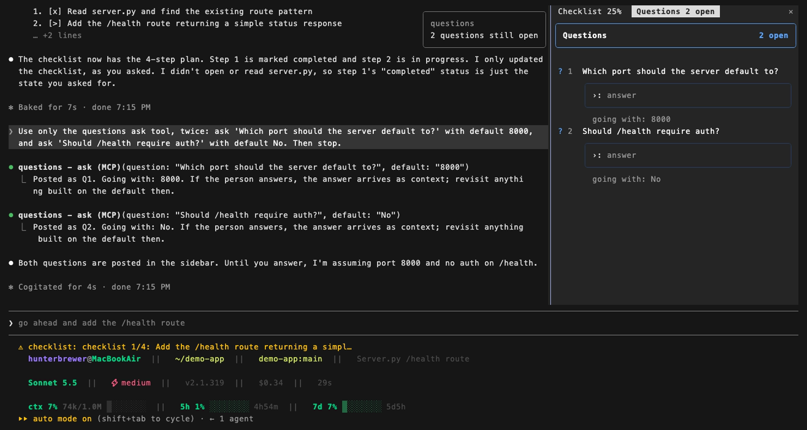
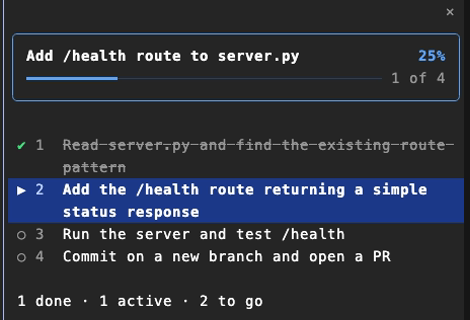
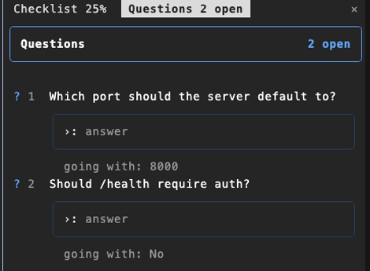
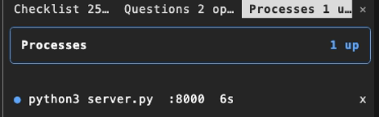
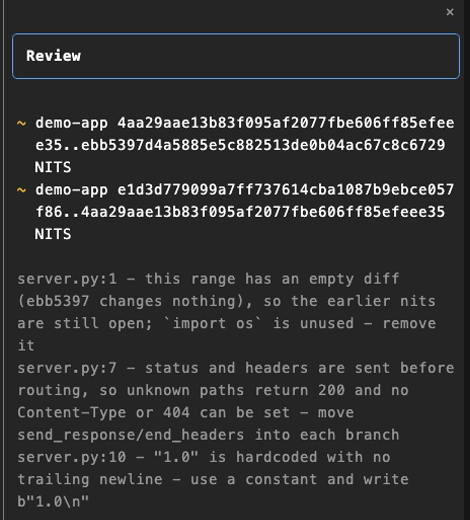
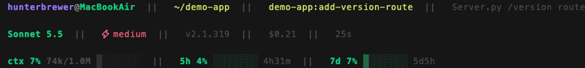

# Claude-Toolkit

My personal [Claude Code](https://docs.claude.com/en/docs/claude-code) setup, packaged as a plugin marketplace so each machine installs only what it needs.

Most of it follows my own paths and conventions, so treat it as patterns to borrow rather than drop-in installs.

## Install

```
/plugin marketplace add hunterbrewer04/claude-toolkit
/plugin install school@brewkit
```

`brewkit` is the marketplace name the repo declares. Swap `school` for any plugin below.

## What's inside

| Plugin | What you get |
|---|---|
| [school](#school) | Coursework skills |
| [personal](#personal) | Apple Calendar |
| [misc](#misc) | Everyday skills and global hooks |
| [dev-flow](#dev-flow) | Spec-to-PR development workflow |
| [meta-builders](#meta-builders) | Skill authoring and evals |
| [sidebar](#sidebar) | Mod: docked sidebar for the widgets below |
| [checklist](#checklist) | Mod: live plan progress |
| [questions](#questions) | Mod: questions that don't stop the work |
| [processes](#processes) | Mod: background commands and dev servers |
| [review-pair](#review-pair) | Mod: a second session that reviews every commit |

Plus a [status line](#status-line). That's 14 skills, 1 sub-agent, 4 hooks, 5 mods, and the status line.

## Skills

### school

| Skill | What it does |
|---|---|
| [notebooklm-course-sync](./plugins/school/skills/notebooklm-course-sync/) | Keep a course's NotebookLM notebook in sync with local files |
| [rubric-check](./plugins/school/skills/rubric-check/) | Grade a draft against its assignment spec before submitting |
| [sapling-ai-detector](./plugins/school/skills/sapling-ai-detector/) | Scan text for AI-generated content, sentence by sentence |

### personal

| Skill | What it does |
|---|---|
| [apple-calendar](./plugins/personal/skills/apple-calendar/) | Read and write Apple Calendar |

### misc

| Skill | What it does |
|---|---|
| [claude-toolkit](./plugins/misc/skills/claude-toolkit/) | Add to this repo, sync it, and set it up on a new machine |
| [docx](./plugins/misc/skills/docx/) | Create and edit Word documents |
| [notebooklm](./plugins/misc/skills/notebooklm/) | Drive NotebookLM: notebooks, sources, artifacts, downloads |
| [tailnet](./plugins/misc/skills/tailnet/) | Move and serve files over Tailscale |

Hooks: block `.env` commits, track agent state, and send a desktop notification when Claude stops.

### dev-flow

| Skill | What it does |
|---|---|
| [spec](./plugins/dev-flow/skills/spec/) | Turn an idea into an approved spec |
| [plan](./plugins/dev-flow/skills/plan/) | Break the spec into tasks |
| [implement](./plugins/dev-flow/skills/implement/) | Build the plan with subagents in git worktrees |
| [review](./plugins/dev-flow/skills/review/) | Review the whole branch |
| [test](./plugins/dev-flow/skills/test/) | Run verification and open the PR |

Also includes a `code-reviewer` sub-agent and a hook that resumes a build after a context clear.

### meta-builders

| Skill | What it does |
|---|---|
| [skill-creator](./plugins/meta-builders/skills/skill-creator/) | Create and improve skills, run evals, benchmark them |

## Mods

[Mods](https://code.claude.com/docs/en/plugins/mods/overview) change Claude Code's own interface. Install `sidebar` along with any of the widgets, since it's what draws them.



### sidebar

Gives each widget its own tab, opening a tab when the widget has something to show. Set `layout` to `stacked` for one pane instead. `/sidebar` opens it and `/sidebar close` hides it.

### checklist

Claude posts its plan and checks off steps as it goes, with any subagents shown under their step.



### questions

Claude asks without stopping and keeps going on a stated default. Answer in the sidebar whenever you get to it, and Claude redoes anything built on that default.



### processes

Lists the background commands and dev servers Claude started, with ports, uptime, and a kill button.



### review-pair

Starts a second Claude session that reviews each commit. Blockers go back to the session doing the work to fix; nits and clean reviews land in the sidebar. The reviewer can't use the Edit or Write tools. `/review-pair` shows the status.



## Status line

Three rows: where you are, what you're running, and what you're burning.



Point `statusLine.command` in `settings.json` at [`statusline-command.sh`](./statusline/statusline-command.sh). Details are in the [status line README](./statusline/README.md).

## Machine-local config

Nothing machine-specific is committed. Two files live outside the repo:

| File | Used by | What it holds |
|---|---|---|
| `~/.claude/tailnet-servers.json` | `tailnet` | Server registry ([example](./plugins/misc/skills/tailnet/servers.example.json)) |
| `~/.claude/settings.json` | everything | Permissions, env, enabled plugins, status line |
